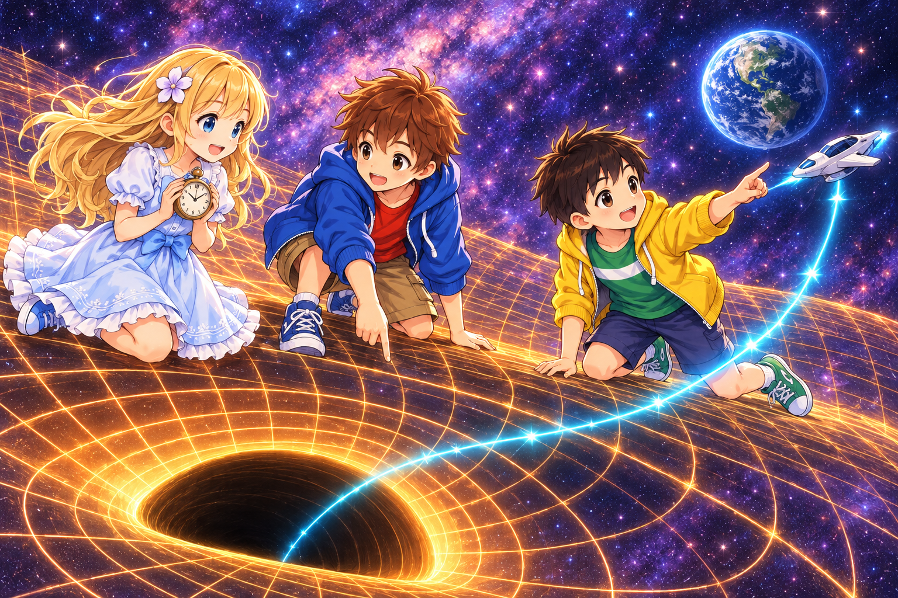

# Making Sense of Relativity

**English** ・ [日本語](README-jp.md)

Last updated: 2026-10-26

---

## About This Guide

This introductory guide helps readers who can follow the equations of relativity but struggle to understand their physical meaning.
It explains Einstein’s special and general relativity in an accessible way through thought experiments and dialogue.

Through concrete setups and observation procedures, this guide works through the feeling that relativity still does not quite make sense, even when you can follow the equations.
From special to general relativity, it explores proper time, coordinate time, simultaneity, and how things appear in a gravitational field through conversations among Alice, Bob, and Charlie.

**Topics covered:** Einstein's special theory of relativity, general theory of relativity, invariance of the speed of light, Lorentz transformation, time dilation, length contraction (Lorentz contraction), relativity of simultaneity, twin paradox, proper time vs coordinate time, equivalence principle, gravitational time dilation, gravitational redshift, Schwarzschild solution, black holes and event horizons, free fall and geodesics, curved spacetime, metric tensor, four-momentum, $E = mc^2$ (mass-energy equivalence)

## Reading Order

The documents are intended to be read in the following order.

1. **Introduction: [A First Introduction to the Lorentz Transformation and Spacetime Invariants](./docs/en/LorentzInvariantIntroduction.md)**
   Restricting space to one dimension, it builds up what the Lorentz transformation is, what it changes, and what it leaves untouched — starting from a comparison with the Galilean transformation. It works through the algebra up to the line element $ds^2 = -c^2 dt^2 + dx^2$ as the observer-independent interval of spacetime. If relativity is new to you, start here.
2. **General relativity series: [A First Introduction to General Relativity](./docs/en/general-relativity/00-Introduction.md)**
   Starting with vectors, tensors, and the metric, this series moves through free fall and curvature to the Einstein equation and the Schwarzschild solution. It follows where each equation comes from and what it means, all the way to measuring spacetime with clocks and light.
3. **Main text: [Making Sense of Relativity](./docs/en/Relativity.md)**
   Taking the tools from the introduction as given, it runs from special to general relativity. Rather than the derivations themselves, the weight is on *physical meaning* — proper time, coordinate time, simultaneity, and how things look in a gravitational field.

## Main Text Contents

- **Chapter 1: Special Relativity**
  - Invariant speed of light, Lorentz transformation, proper time vs coordinate time, time dilation
  - Relativity of simultaneity, length contraction
- **Chapter 2: General Relativity**
  - Metric tensor, Schwarzschild solution, coordinates as a canvas
  - Proper vs coordinate quantities in a gravitational field, gravitational redshift
  - Free fall, event horizon behavior, interferometer thought experiment
- **Appendix A–D**
  - Lorentz invariance of $ds^2$ and sign convention note
  - Simultaneity offset in moving frames
  - Length contraction derivation
  - Four-momentum and $E = mc^2$

## Comics

A short coffee-break comic corner.

- Comic 1: [manga-1.png](./images/manga-1.png)
- Comic 2: [manga-2.png](./images/manga-2.png)
- Comic 3: [manga-3.png](./images/manga-3.png)

## Contact

Questions and corrections are welcome via the inquiry form (JP/EN): <https://forms.gle/d5QrngqCdRKYXhzs8>

## Related Keywords

relativity made easy, introduction to relativity, relativity for beginners, relativity explained, special relativity made easy, general relativity made easy, time dilation made easy, Lorentz transformation made easy, Einstein’s relativity, twin paradox explained, black holes and relativity, gravity and time, why the speed of light is invariant, meaning of E=mc2, curved spacetime explained, what is proper time, what is coordinate time, equivalence principle made easy, gravitational redshift explained, introduction to the Schwarzschild solution

---

Copyright(C) 2026 t-ishii66. All rights reserved.

<!-- SEO intro added by setup-github-pages; review and adjust -->
<!-- /SEO intro -->
