# Making Sense of Relativity

_Notes Toward Understanding Relativity_

## Table of Contents

- Introduction
- Characters
  - Alice
  - Bob
  - Charlie
- Chapter 1: Special Relativity
  - The Principle of Invariant Light Speed
  - Lorentz Transformation
  - Setup and Characters
  - Proper Time and Coordinate Time
  - How Clocks Tick
  - Relativity of Simultaneity
  - Length Contraction
- Chapter 2: General Relativity
  - Setup and Characters
  - Metric
  - Schwarzschild Solution
  - Coordinates as a Canvas
  - Coordinate Time and Proper Time
  - Gravitational Redshift
  - Proper Length and Coordinate Length
  - Speed of Light in a Gravitational Field
  - Coordinate Systems as a Canvas
  - A Freely Falling Observer
  - Light Signals from Falling Bob
  - Bob and Charlie Meet Again
  - Metric and Coordinate Transformations
  - Interferometer Thought Experiment
- Appendix
  - Appendix A: Why is $ds^{2}$ invariant under Lorentz transformations?
  - Appendix B: Why do SB clocks look desynchronized from SA?
  - Appendix C: Deriving Length Contraction with Lorentz Transformations
  - Appendix D: Four-Momentum and $E = mc^{2}$
- References
- Credits
- Closing

## Introduction

The picture of the world that relativity presents is difficult to grasp intuitively, and it can even seem to involve mysterious phenomena. Perhaps many of you can follow the algebra but still feel that its meaning does not quite make sense. In this book, we will use simple setups to unravel the mysteries behind these puzzling phenomena.

The discussion itself is fairly informal, so do not worry about the finer details; just read on at your own pace. This book does not cover the derivation of the basic equations or the development of the theory of relativity itself. Those topics are covered in the introductory texts, [A First Introduction to the Lorentz Transformation and Spacetime Invariants](./LorentzInvariantIntroduction.md) and [A First Introduction to General Relativity](./general-relativity/00-Introduction.md), so refer to them whenever you wonder where an equation comes from. Even if you can follow the equations, though, I suspect that some things may still not quite make sense. If so, come back to this book.

Let’s begin!

## Characters

### Alice

Personality: Very curious and quick to say what is on her mind. Does not let things go until they make sense to her.

Hobbies: Watching stars, reading storybooks, collecting pretty stones.

Likes: Strawberry milk, blue ribbons, mysterious stories.

### Bob

Personality: Calm and a little pedantic. The type who observes first rather than jumping to a conclusion without thinking.

Hobbies: Crafting, maps, taking clocks apart and reassembling them.

Likes: Hamburgers, toolboxes, new notebooks.

### Charlie

Personality: Seems easygoing, but is surprisingly perceptive. Good at seeing the big picture from a distance.

Hobbies: Naps, walks, watching cloud shapes.

Likes: Melon bread, wide scenery, binoculars.

## Chapter 1: Special Relativity

### The Principle of Invariant Light Speed

An inertial frame is a frame moving at constant velocity in a straight line. A rest frame means an inertial frame in which the observer is at rest.

In any inertial frame, the measured speed of light in vacuum is always $3 \times 10^{8}\,[m/s]$. Even if you chase light in a uniformly moving rocket, you still measure the same value. Strange, but experimentally true. This is the principle of invariant light speed.

### Lorentz Transformation

In this book we mostly use one spatial dimension, so spacetime is 2D: time + one space axis.

Let SA and SB be inertial frames, with SB moving at speed $V$ relative to SA. Coordinates are $(t_A,x_A)$ and $(t_B,x_B)$.

The spatial coordinate in SB can be expressed in terms of the SA coordinates in the following form. Here, $\gamma$ is a coefficient whose value we will determine later.

$$
x_B = \gamma(x_A - Vt_A)
$$

The origin of SB, $x_B=0$, is at $x_A=Vt_A$ in SA, so this seems consistent. Conversely, the transformation from SB to SA can be written as

$$
x_A = \gamma(x_B + Vt_B)
$$

This is because only the sign of the velocity $V$ changes; everything else about the situation remains the same.

We can also solve for $t_B$:

$$
t_B = \frac{1-\gamma^2}{\gamma V}x_A + \gamma t_A
$$

Now impose invariant light speed. Emit light when SA and SB origins coincide:

$$
x_A = ct_A, \quad x_B = ct_B
$$

Substitute:

$$
ct_B = \gamma(ct_A - Vt_A), \quad ct_A = \gamma(ct_B + Vt_B)
$$

Then

$$
c^2 = \gamma^2(c^2 - V^2),
$$

so

$$
\gamma = \frac{1}{\sqrt{1-(V/c)^2}}
$$

Therefore,

$$
x_B = \frac{x_A - Vt_A}{\sqrt{1-(V/c)^2}},
$$

$$
t_B = \frac{t_A - Vx_A/c^2}{\sqrt{1-(V/c)^2}}
$$

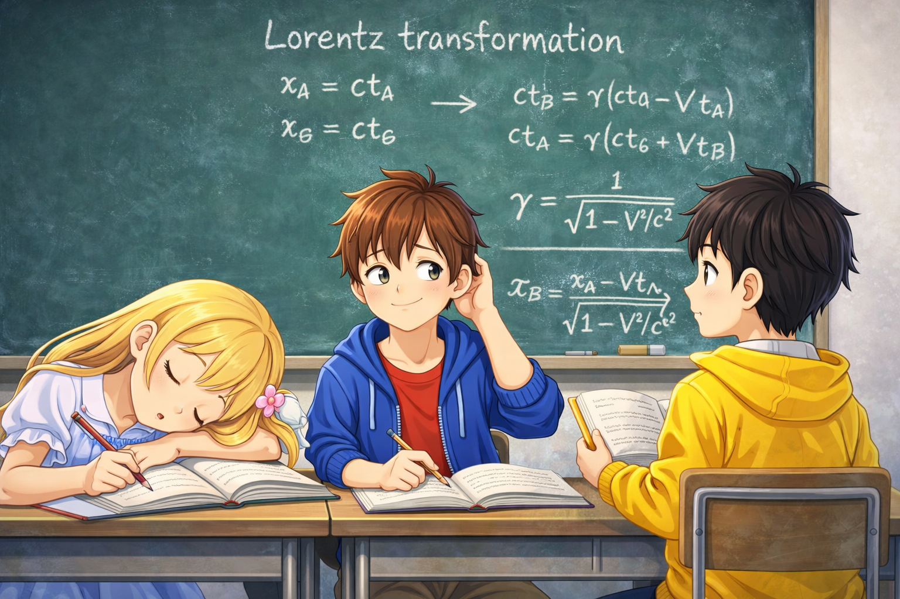

---

Alice: “I’ll read those equations later… just a tiny nap…”

Bob: “Alice is completely asleep. I kind of understand, though.”

Charlie: “I’ll keep following the math a little longer.”

---

### Setup and Characters

We have two inertial frames, SA and SB. Alice is at rest in SA and has a clock. Bob is at rest in SB and also has a clock. SB moves at speed $V$ relative to SA.

That is the whole setup.

| Character | Setup |
| --- | --- |
| Alice | At rest in SA, carrying a clock |
| Bob | At rest in SB, carrying a clock |

### Proper Time and Coordinate Time

Clocks are densely distributed throughout SA and fixed to its coordinate grid (the square clocks in the figures). These clocks keep coordinate time. Let us call them coordinate clocks. Coordinate time is the time shown by clocks fixed to the coordinate grid in this way. Whenever coordinate time is mentioned, think of the readings on these square clocks.

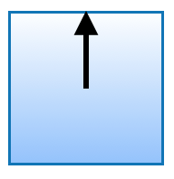

Alice carries a clock, which keeps her proper time. Proper time is defined as the time shown by a clock attached to an object. In the figures, it is drawn as a round clock (a proper clock). Alice herself is not drawn, but please think of the round clock as Alice.

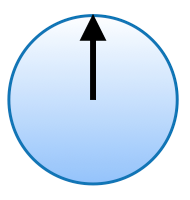

There is no particular difference in how coordinate clocks and proper clocks are manufactured. The same manufacturer produces them to the same accuracy. Only their shapes differ.

All the square clocks in SA and Alice’s clock, which is at rest in SA, are synchronized. SB, where Bob is at rest, is set up in the same way. The figures are drawn from a viewpoint at rest in either SA or SB. Each figure states which viewpoint is used, so there should be no confusion.

We use $w$ for coordinate-time readings and $\tau$ for proper-time readings. Their units are actually units of distance, not time (dividing by the constant $c$ gives ordinary time). What this means is that we multiply time $t$ by the constant speed of light in vacuum, $c$, and define

$$
w = ct
$$

Similarly, we multiply the reading on a proper-time clock by $c$ and call the result $\tau$. Please keep in mind that the text still treats $w$ and $\tau$ as time.

SB moves at velocity $V$ relative to SA. Alice is at rest in SA, and her proper time $\tau_A$ and the coordinate time $w_A$ are synchronized, so of course $\tau_A=w_A$. Every coordinate clock shows the same time. The same applies to SB, where Bob is, so $\tau_B=w_B$. With all this in mind, let us begin our investigation.

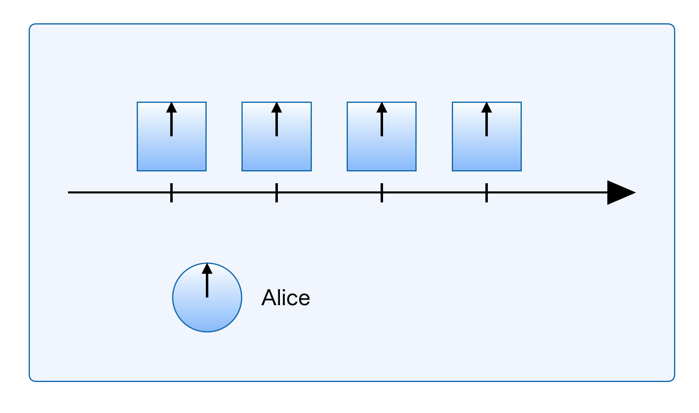

*Figure 1.1 (SA view): Proper clock and coordinate clocks*

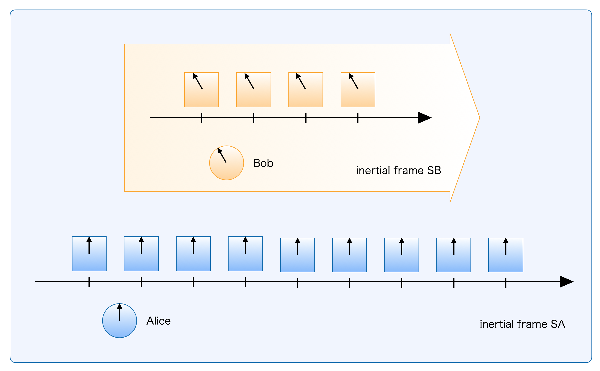

*Figure 1.2 (SA view): Relationship between SA and SB (conceptual)*

---

Alice: “So the round one is proper time and the square one is coordinate time? Same store, same clocks… weird.”

---

### How Clocks Tick

First, let us investigate how Bob’s clock ticks as seen from SA. In SA, Bob moves in a straight line at constant velocity in the direction of the arrow (to the right). Let us consider the relationship between Bob’s proper time $\tau_B$ and SA’s coordinate time $w_A$.

As Bob moves, he passes points P and Q in SA. When we consider his passage through these two points, there is actually more than one SA coordinate clock being compared with Bob’s proper clock. In other words, Bob’s single proper clock is compared with two different SA coordinate clocks, one at P and one at Q.

The table below shows the relationship between the coordinate clocks at P and Q and Bob’s proper clock.

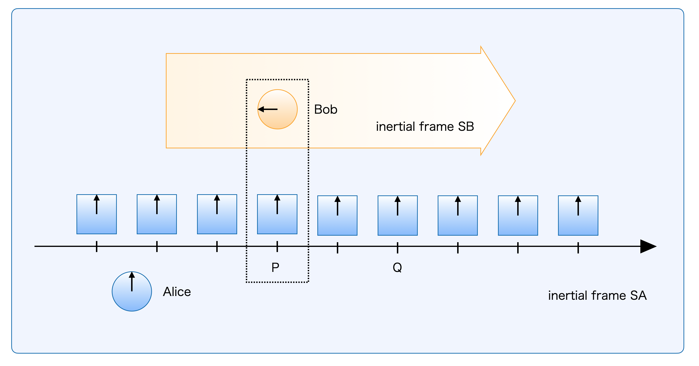

*Figure 1.3 (SA view): Bob’s proper clock and SA coordinate clocks*

|  | Bob (SB) | SA |
| --- | --- | --- |
| At P | Bob looks at his own clock and reads $\tau_P$. | When Bob passes in front of the SA coordinate clock at P, that clock reads $w_P$. |
| At Q | Bob looks at his own clock and reads $\tau_Q$. | When Bob passes in front of the SA coordinate clock at Q, that clock reads $w_Q$. |
| Interval P to Q | Bob took $\Delta\tau_B = \tau_Q - \tau_P$ to travel from P to Q. | Bob took $\Delta w_A = w_Q - w_P$ to travel from P to Q, as measured by SA. |

This distinction is crucial: the proper-time difference $\Delta\tau_B$ is the elapsed time on Bob's single clock, while the coordinate-time difference $\Delta w_A$ is the difference between readings on two different SA clocks at P and Q. (This is not always the case, but it is for this situation.)

Let the spatial separation between P and Q, as measured in SA, be $\Delta x_A$.

Up to this point, we have used $\Delta$ for the finite differences between the separated points P and Q. To treat them mathematically from this point onward, consider the limit in which the separation between P and Q becomes indefinitely small. In that limit, write

$$
\Delta\tau_B\longrightarrow d\tau_B,\qquad
\Delta w_A\longrightarrow dw_A,\qquad
\Delta x_A\longrightarrow dx_A
$$

Below, we use $d$ to represent these infinitesimal differences. If the line element is $ds^{2}$, define

$$
ds^2 = -dw_A^2 + dx_A^2
$$

This quantity is Lorentz invariant (derivation in Appendix A).

In Bob’s own frame, Bob is at rest so $dx_B=0$, hence

$$
ds^2 = -dw_B^2 = -d\tau_B^2
$$

---

Bob: “My $ds^2$ is this value, computed from my own clock.”

Alice: “Wait... if I compute with my coordinate clocks... what, same $ds^2$!?”

---

$ds^2$ is a quantity that we might call the distance between two adjacent points in spacetime (time and space; since this book uses one spatial dimension, spacetime has two dimensions in total). Whenever $ds^2$ appears, keep the “two endpoints” in mind. Let us now consider the line element as Bob moves from P to Q.

Since $ds^2$ is invariant under Lorentz transformations—that is, it has the same value whether Bob calculates it or it is calculated in SA—we can write

$$
-d\tau_B^2 = -dw_A^2 + dx_A^2,
$$

so

$$
d\tau_B = dw_A\sqrt{1-(dx_A/dw_A)^2} = dw_A\sqrt{1-(V/c)^2}
$$

Therefore $d\tau_B < dw_A$. Looking at this result, Alice began to explain. The SA coordinate time $w_A$ and her own clock $\tau_A$ are synchronized, so they can be regarded as the same.

Therefore, Bob’s clock runs more slowly than Alice’s.

---

Alice: “Bob’s clock is ticking slowly. It must be broken.”

---

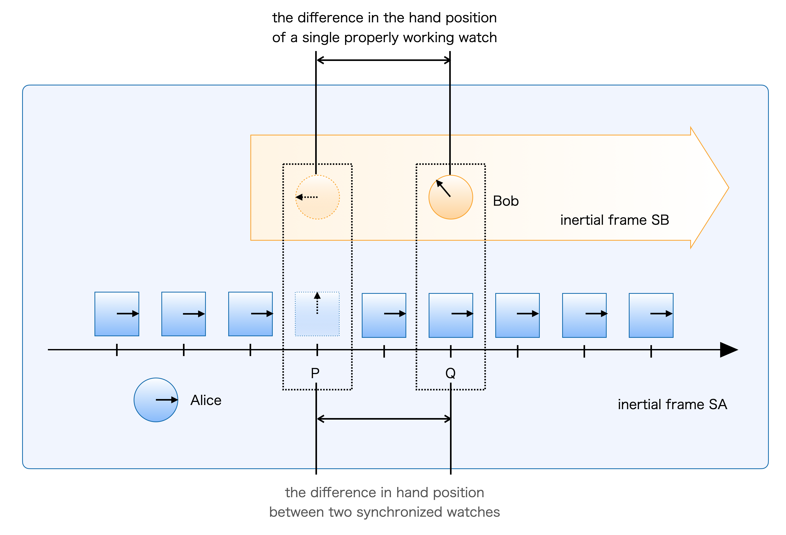

*Figure 1.4 (SA view): Proper-time interval vs coordinate-time interval*

|  | Bob (SB) | SA |
| --- | --- | --- |
| Time from P to Q | Bob carries his own clock, so he measures this as $\Delta\tau_B$. | Difference between the SA clock reading when Bob passes P and the SA clock reading when Bob passes Q. This is $\Delta w_A$. |
| Distance from P to Q | Zero. To make this intuitive: Bob is an SB resident and is at rest in SB. From Bob’s viewpoint, SA is what moves; first point P comes to him (first spacetime event), then point Q comes (second spacetime event). Between those two events, Bob’s traveled distance in SB is zero. | SA-measured distance $\overline{PQ}$, i.e. $\Delta x_A$. |

Alice did not know it, but Bob had been observing the rate of Alice’s proper clock using the SB coordinate clocks. He had reached the following conclusion:

> Alice’s clock runs slower than Bob’s clock.

Well, we have simply swapped their roles, so it is only natural that Bob makes the same claim about Alice’s clock.

---

Bob: “Alice’s clock is broken, isn’t it?”

Alice: “No way. Maybe your clock is the broken one.”

---

Is this a contradiction in the theory? Let us think about it in the next section.

### Relativity of Simultaneity

Previously, we observed Bob’s proper clock using the SA coordinate clocks. This time, we will use the SA coordinate clocks to observe each of the SB coordinate clocks. Since the situation has not changed, each clock in SB should appear to tick slowly as seen from SA. But if we take Bob’s claim—that Alice’s clock ticks slowly—into account,

> the coordinate clocks in SB must appear to show different times

when compared at the same SA time.

Let us consider how the SB coordinate clocks observe Alice’s proper clock.

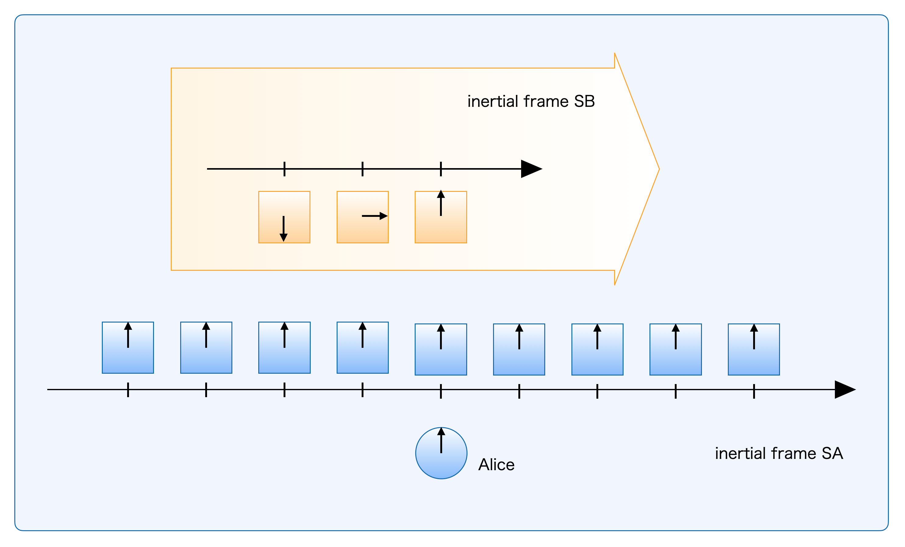

*Figure 1.5 (SA view): SB coordinate clocks from SA*

Suppose that, as shown in the figure, the leading SB clock and Alice’s clock happen to both show 12 o’clock.

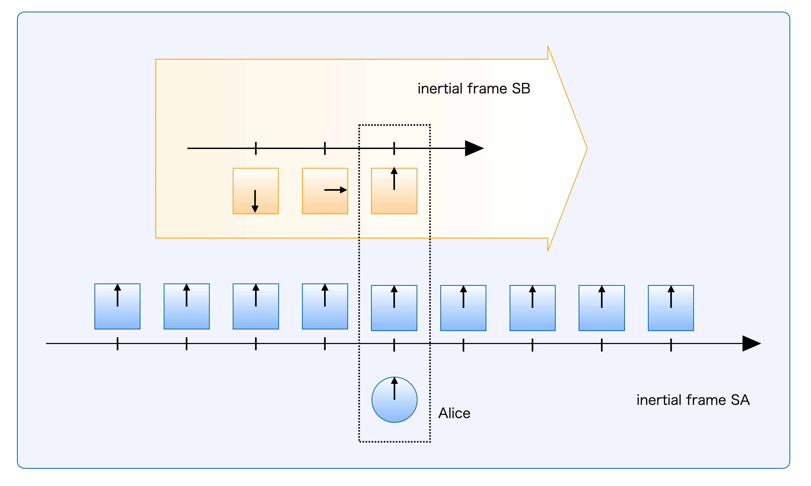

*Figure 1.6 (SA view): Rightmost SB clock happens to match Alice at one event*

After a little time has passed, the picture will look like this.

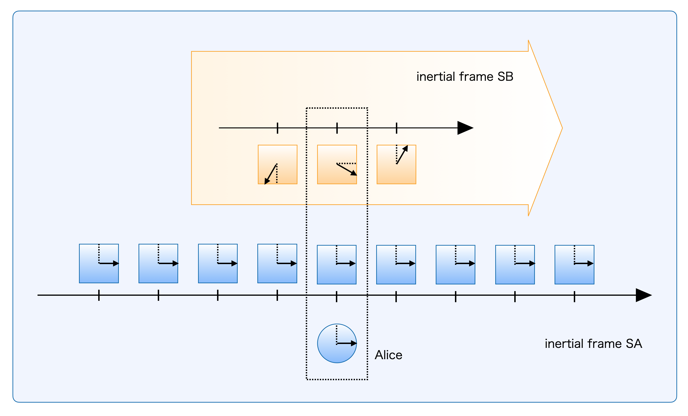

*Figure 1.7 (SA view): The second SB coordinate clock observes Alice’s proper clock*

From SA's fixed viewpoint, all SA clocks tick fast (in Figure 1.7, the blue coordinate clock hands move from 12 o'clock to 3 o'clock), while each SB clock ticks slowly (but all at the same slow rate).

Focus on two adjacent SB coordinate clocks. Both tick slowly as seen from SA. "Slowly" here refers to the rate at which the hands move, not the displayed time. Surprisingly, these two SB clocks believe they show the same time as each other. When these two clocks observe Alice's proper clock, the following situation arises.

When Alice passes in front of the rightmost SB clock, that SB clock and Alice’s clock happen to show the same time (this is just a coincidence). But when Alice passes in front of the second SB clock (second from the right), that clock finds Alice's clock is behind. Since all SB coordinate clocks are synchronized with each other, SB concludes that Alice's clock is running slower than theirs.

When we compare multiple SB coordinate clocks with an SA proper clock (Alice's clock, or any single SA coordinate clock treated as a proper clock), SA proper time still appears to run slower. Both Alice's and Bob's claims turn out to be correct. In special relativity, comparing one proper clock against two coordinate clocks leads to this seemingly strange result. But there is no contradiction.

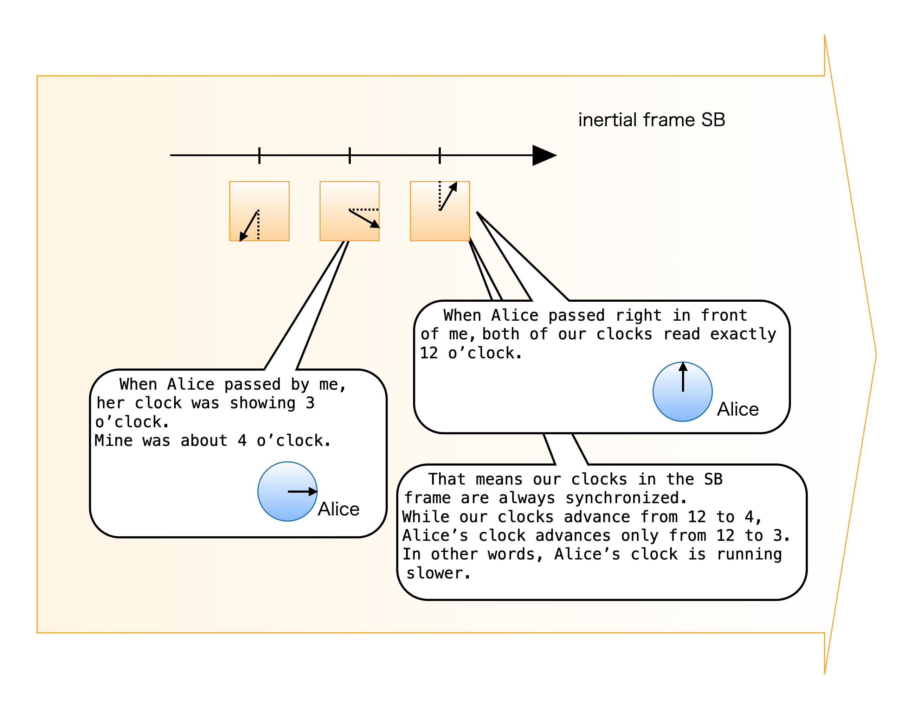

*Figure 1.8: Alice's clock seen via multiple SB coordinate clocks*

---

Alice: “Bob kept insisting, ‘Synchronize all the clocks properly.’ But what about his side? I’ll get him for this later.”

Bob: “Hmm… still, I feel like Alice’s clock is the one that’s off.”

---

### Length Contraction

This time, let us measure from SA the length of a rod at rest in SB. Measuring length means

> identifying the positions of both ends of the rod simultaneously.

Suppose that, observing from SA, we identify the two ends as points P and Q (both are points in SA).

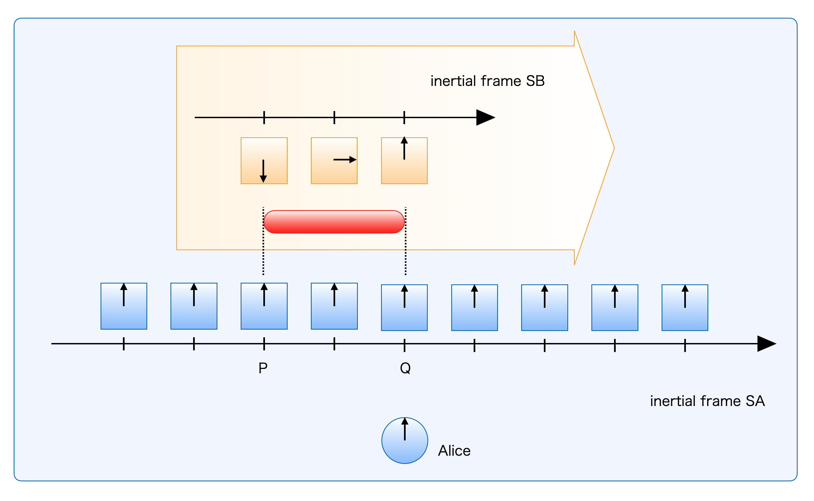

*Figure 1.9 (SA view): SA measuring a rod at rest in SB*

What does this measurement in SA look like from SB? From here on, let us draw the figures from SB’s viewpoint. Seen from SB, it appears that SA identified point Q as the rod’s front end when the front end reached Q. The SA coordinate clock at Q (point Q in Figure 1.10) read 12 o’clock.

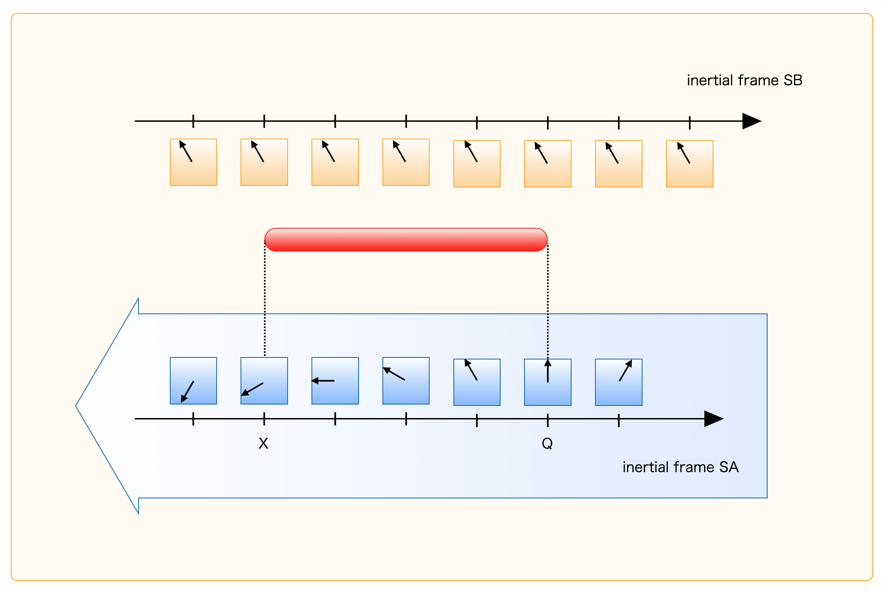

*Figure 1.10 (SB view): SA identifies the position of the front end of the rod at rest in SB*

Strangely, however, there was no sign of measuring the position of the rear end. Looking over at the rear end, we find that the coordinate clock at the corresponding point X in SA is far behind and has not yet reached 12 o’clock.

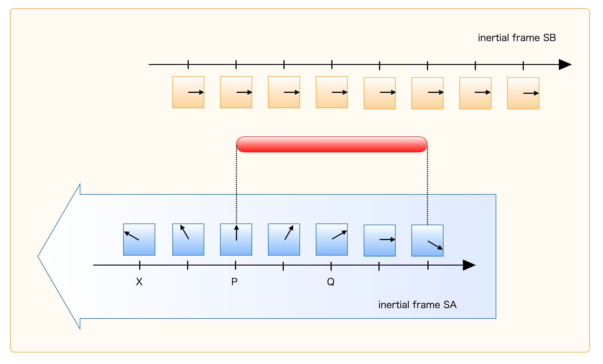

*Figure 1.11 (SB view): SA identifies the position of the rear end of the rod at rest in SB*

Eventually the rear endpoint reaches point P, and at that moment the SA clock at P reads 12 o'clock. That is when SA identifies the rear endpoint as P.

Alice gets excited and says that the rod became shorter. For Alice, this is a correct length measurement because the positions of both ends of the rod were identified simultaneously in SA. From Bob’s point of view, however, those two measurement events are not simultaneous. Therefore, the result cannot be called the length of the rod in Bob’s frame.

---

Bob: “Alice, you’re way too clumsy. I just told you that you have to measure the positions of both ends at the same time…”

---

Conversely, what happens when SB measures the distance $\overline{PQ}$ in SA?

Of course, the positions of P and Q must be identified “simultaneously” in SB. Suppose the measurements are made when the coordinate clock hands point straight down. Let us return to SA’s viewpoint. First, the SB coordinate clock corresponding to P identifies its position.

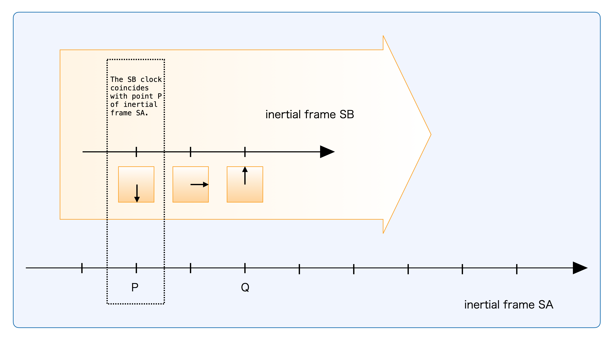

*Figure 1.12 (SA view): SB identifies P*

However, the hand of the coordinate clock that measures Q is not yet pointing straight down. Only after a little time has passed is Q finally identified.

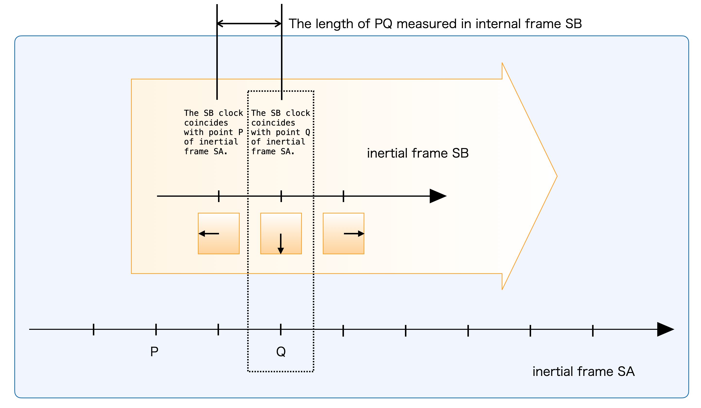

*Figure 1.13 (SA view): SB measures the position of Q*

In this way, when SB measures a length in SA, it also measures it as shorter. In fact, this explanation is far too rough. If you would like a more accurate account, see Appendix B and C. Otherwise, let us proceed to general relativity.

## Chapter 2: General Relativity

Consider an astronaut in a uniformly accelerating rocket, holding an apple. Throw the apple, and inside the rocket it appears to follow a curved trajectory.

*Apple in an accelerating rocket*

Viewed from outside the rocket, however, the apple moves in a straight line at constant velocity, while the astronaut accelerates.

Let us apply this idea to the ground. When we throw an apple on the ground, it follows a parabolic trajectory. However, this does not mean that the apple moves in a straight line at constant velocity throughout the gravitational field.

Here we need a change in perspective. In general relativity, a freely falling object does not feel gravity as a force; instead, it follows a path that is as straight as possible through spacetime. This path is called a geodesic. If we look only very close to the freely falling apple and for a very short time, we can treat its motion in the same way as uniform motion in special relativity.

By contrast, we who stand on the ground are not in free fall, because an upward force from the ground supports us. The difference between the motion of the freely falling apple and our motion while supported by the ground appears as the apple’s parabolic trajectory in ground coordinates. In general coordinates, the coordinate velocity of an object following a geodesic can change.

In the rocket, acceleration points in one direction, whereas gravity points toward the center of the celestial body. This makes the situation fundamentally different from that in the rocket.

Trying to build one coordinate system where every point on Earth’s surface is “accelerating upward” becomes difficult. Einstein resolved this by introducing Riemannian geometry into physics.

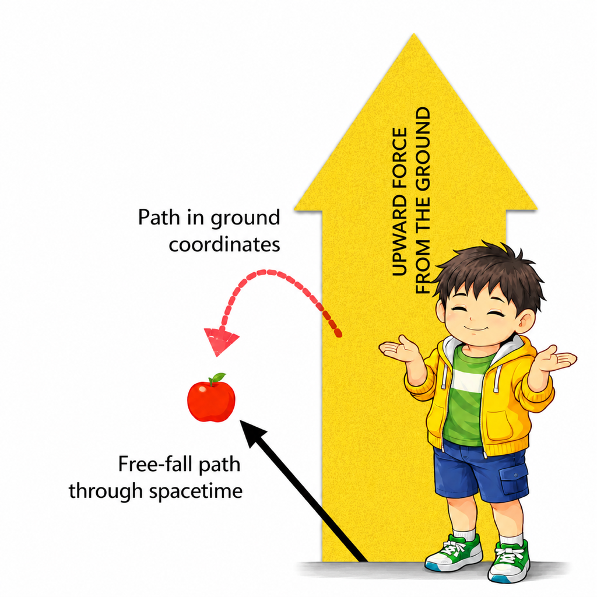

*The parabolic path in ground coordinates and the free-fall geodesic through spacetime*

### Setup and Characters

In this chapter, let us explore how to think about time and space in a gravitational field. There is a single celestial body with a large mass. Take its center as the origin of the spatial coordinates, and for now consider just one spatial dimension, the radial direction.

Alice stands at $r_A$, where she strongly feels the body’s gravity (on the roof of a building). Charlie is held in place almost infinitely far away, at a location we call $r_C$ (so he does not fall toward the body), and feels no gravity. That is the whole setup.

Alice and Charlie each carry a clock and can measure their proper time whenever they wish (defined simply as the time shown by the clock each carries).

| Character | Setup |
| --- | --- |
| Alice | At rest on the roof of a building on the body’s surface, at $r_A$ from its center. Feels strong gravity. |
| Charlie | Observes Alice from infinitely far away from the body. Is in a true inertial frame and feels no gravity. His distance from the body’s center is $r_C$, which is almost infinite. |

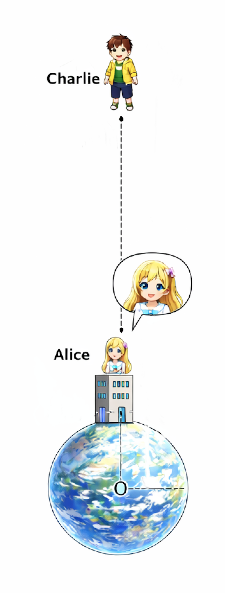

### Metric

Let inertial Minkowski metric be

$$
\eta_{\mu\nu}=
\begin{pmatrix}
-1&0&0&0\\
0&1&0&0\\
0&0&1&0\\
0&0&0&1
\end{pmatrix}
$$

*The metric in an inertial frame*

In fact, even in an inertial frame, using coordinates such as polar coordinates makes the metric differ from $\eta_{\mu\nu}$, which can cause confusion. (Of course, calculating the curvature lets us distinguish flat spacetime from curved spacetime, but this book does not go into that.) In this book, we adopt the convention of always writing the metric in an inertial frame as $\eta_{\mu\nu}$, and writing the metric in coordinates describing spacetime curved by gravity as $g_{\mu\nu}(\neq\eta_{\mu\nu})$. (Since coordinate transformations can always be made, we can regard the necessary transformations as implicit. In an inertial frame, an implicit coordinate transformation is understood to put the metric into the form $\eta_{\mu\nu}$.)

With inertial coordinates $X^\mu$ and arbitrary coordinates $x^\mu$:

$$
dX^\mu = \frac{\partial X^\mu}{\partial x^\nu}dx^\nu,
$$

and define the line element by

$$
ds^2=\eta_{\mu\nu}dX^\mu dX^\nu
$$

Rewriting:

$$
ds^2=\eta_{\mu\nu}
\frac{\partial X^\mu}{\partial x^\rho}dx^\rho
\frac{\partial X^\nu}{\partial x^\tau}dx^\tau,
$$

and collecting terms gives

$$
ds^2=g_{\rho\tau}dx^\rho dx^\tau,
$$

with

$$
g_{\rho\tau}=\eta_{\mu\nu}\frac{\partial X^\mu}{\partial x^\rho}\frac{\partial X^\nu}{\partial x^\tau}
$$

However, $X^\mu$ here denotes local inertial coordinates chosen in the immediate neighborhood of a point in curved spacetime. This relation applies only locally; it does not mean that an entire finite region can be transformed to the Minkowski metric $\eta_{\mu\nu}$. By choosing suitable coordinates, we can put the metric into the form $\eta_{\mu\nu}$ at a point, but we cannot eliminate the curvature of spacetime.

Let us focus on the following equation.

$$
ds^2=g_{\rho\tau}dx^\rho dx^\tau
$$

We can read it as saying that, for the quantity $ds^2$ calculated in a (local) inertial frame, a person in the gravitational field can obtain the same value by calculating $g_{\rho\tau}dx^\rho dx^\tau$ using the metric $g_{\rho\tau}$. In other words, we can understand the metric as what allows us to calculate the line element between two spacetime points in any coordinate system, whether in a (local) inertial frame or in the gravitational field.

If the relation between $X^\mu$ and $x^\mu$ (equivalently $g_{\rho\tau}$) were already known, that would be convenient. In general, $g_{\rho\tau}$ is determined by energy-momentum distribution $T^{\mu\nu}$ (through Einstein’s equations; details are outside this book).

Let us now consider the meaning of time and distance in curved spacetime.

Also, if basis vectors of $x^\mu$ are defined by

$$
{e_{\mu}}^{\lambda}=\frac{\partial X^{\lambda}}{\partial x^{\mu}},
$$

then

$$
g_{\rho\tau}=\eta_{\mu\nu}{e_{\rho}}^{\mu}{e_{\tau}}^{\nu}
=(\mathbf{e}_{\rho}\cdot\mathbf{e}_{\tau}),
$$

so the metric is the inner product of basis vectors.

### Schwarzschild Solution

Most books present the Schwarzschild solution. It is obtained by considering the gravitational field of a single celestial body with spherical symmetry and finding the coordinates and the metric. The result is

$$
ds^{2}=-\left(1-\frac{a}{r}\right)dw^{2}+\frac{1}{1-a/r}dr^{2}+r^{2}d\Omega^{2},
$$

where $a$ is called the Schwarzschild radius and

$$
a=\frac{2GM}{c^{2}},
$$

Here, $G$ is the gravitational constant and $M$ is the mass of the body. Also,

$$
d\Omega^{2}=d\theta^{2}+\sin^{2}\theta d\phi^{2}
$$

but since this book considers only the radial direction, we have

$$
ds^{2}=-\left(1-\frac{a}{r}\right)dw^{2}+\frac{1}{1-a/r}dr^{2}
$$

Now, did you immediately understand what this Schwarzschild solution means? In this chapter, we will mainly explore this solution.

The first things that catch our attention in the equation are $w$ and $r$. Should we call this a $w-r$ coordinate system? Let us think about coordinates in the next section.

### Coordinates as a Canvas

Solving the gravitational field equations gives us the coordinates and the metric together. What exactly are the coordinates obtained in this way?

A coordinate system is simply like a canvas needed to describe phenomena and carry out calculations. We should not look for the familiar “time itself” or “distance itself” in it.

Coordinate time and spatial coordinates provide shared scales for placing events on this canvas. Coordinate differences do not necessarily equal the time measured by a physical clock or the distance measured with a ruler.

To make this distinction concrete, imagine placing a “coordinate clock” at every location, all displaying the same coordinate time $w$. These are imaginary clocks that display the coordinate time assigned to events at their locations. On a surface of constant $w$, every coordinate clock shows the same value. When $w$ increases by a given amount, every display increases by that same amount. In this sense, coordinate clocks advance in the same way everywhere.

This book uses $w=ct$, so a display in seconds would read $w/c$. When coordinate time advances by one second—that is, when $w$ increases by $c\times1\,\mathrm{s}$—every coordinate clock’s display in seconds advances by one second. This is how we define the shared scale, rather than a physical law about real clocks.

If we instead place physical clocks at different locations, each records its own proper time. How many seconds a physical clock records while a coordinate clock advances by one second depends on the clock’s motion and the spacetime metric. Clocks at different locations or with different motions can therefore advance differently. In general, physical clocks do not keep pace with coordinate clocks.

In the special relativity chapter, we synchronized physical clocks at rest in an inertial frame and used them as coordinate clocks. In that case, we could match the shared coordinate-time scale to the proper time recorded by those clocks. With general coordinates, we cannot assume this same correspondence for clocks at every location.

The same distinction applies to space. Intervals of equal coordinate length need not have equal lengths when measured with physical rulers. The metric connects coordinate differences on the canvas to measurements made with physical clocks and rulers.

For example, even in flat space, suppose we describe space by a flat coordinate $r$ and then apply an arbitrary reparameterization

$$
R=f(r)
$$

Then

$$
dR=f'(r)\,dr
$$

Since $r$ is a flat coordinate, $dr$ corresponds to the same length everywhere, but the length corresponding to $dR$ varies with position.

The point is that neither the coordinate values $(w,r)$ nor the infinitesimal increments $(dw,dr)$ in the coordinates obtained by solving the gravitational field equations should be trusted as “time itself” or “distance itself.” We can go further and mix time and space in a coordinate transformation such as $W=f(w,r)$. We would then be considering unfamiliar coordinates that cannot be interpreted simply as either time or space. So we cannot give a simple answer to what $w$ or $r$ means.

On the other hand, measurement is essential in physics. “Measured time” and “measured distance” give us a familiar coordinate system. What matters is the relationship between this familiar coordinate system and the $w-r$ coordinate system used as a canvas.

### Coordinate Time and Proper Time

With one spatial dimension, the Schwarzschild solution is

$$
ds^{2}=-\left(1-\frac{a}{r}\right)dw^{2}+\frac{1}{1-a/r}dr^{2}
$$

Substituting $r=\infty$ into this equation gives

$$
ds^{2}=-dw^{2}+dr^{2}
$$

This is exactly the expression for an inertial frame. It describes the line element between two spacetime points near Charlie. Since Charlie feels no gravity, there is nothing contradictory about this. Let $\tau_C$ be the time kept by Charlie’s clock and consider the line element along its motion. Since Charlie is at rest, $dr_C=0$, so

$$
ds^{2}=-d\tau_C^{2}=-dw^{2}
$$

Thus we obtain

$$
d\tau_C=dw
$$

Thus, the shared coordinate-time increment $dw$ equals the proper-time increment $d\tau_C$ of Charlie, who is at rest at infinity. However, a clock elsewhere need not record the same proper-time increment during that same $dw$. What can differ is not the shared coordinate-time scale, but the proper time each clock records over the corresponding interval. Let us examine this.

Now write the line element at Alice’s radius $r_A$:

$$
ds^{2}=-\left(1-\frac{a}{r_A}\right)dw^{2}+\frac{1}{1-a/r_A}dr^{2}
$$

This gives the line element between two points near Alice. This time, things do not look so simple.

Now suppose light is emitted from Alice’s location at coordinate time $w_{A1}$ (using $w$, the clock on our canvas), and takes a time $W$ to reach Charlie:

$$
w_{A1}+W=w_{C1}
$$

The equation above says that the light reaches Charlie at coordinate time $w_{C1}$. Coordinate time is time assigned within a coordinate system, so it lets us write a relation between different locations, Alice’s and Charlie’s. That is why it is called “coordinate” time. Proper time, by contrast, is specific to Alice or to Charlie; it belongs to each clock individually rather than being a shared time coordinate. That is why it is called “proper” time.

What happens if, a little later, light is emitted again from Alice’s location at time $w_{A2}$? Of course, the time it takes to reach Charlie is still $W$ (it would be strange if it changed).

$$
w_{A2}+W=w_{C2}
$$

Subtracting:

$$
(w_{A2}-w_{A1})=(w_{C2}-w_{C1}),
$$

In other words, the time difference at Alice’s location—strictly in coordinate time—is observed unchanged at Charlie’s location. One second on a coordinate clock at Alice’s location corresponds to one second on a coordinate clock at Charlie’s location. In differential form, we can write

$$
dw_A=dw_C
$$

Still, we must be careful: coordinate time $w$ is a canvas variable. It is not automatically “experienced time.”

Let us now focus on the relationship between proper time and coordinate time. Even in a gravitational field, proper time is defined as the time kept by a clock attached to an object. Let it be $\tau$ in the equation

$$
ds^2=-d\tau^2
$$

But we originally defined proper time in an inertial frame. Can we really define the proper time of Alice, who feels gravity, in the same way?

Suppose Alice is initially in an inertial frame. Time and distance are no different from those we use in everyday life. Suppose she has a clock and a ruler.

Now move Alice into a gravitational field, taking her clock and ruler with her. Time and space may be distorted, but her entire neighborhood is distorted, and Alice is affected along with it, so she has no way to notice that distortion. Looking at her clock, she cannot feel that it is running more slowly or more quickly, because the clock, Alice herself, and her surroundings should all keep time at the same pace. The same applies to space: Alice and the space immediately around her are distorted together, so she has no way to notice it herself. If her surroundings were to shrink to half their size, Alice would also shrink to half her size, and so would her ruler. She would not notice a change in length by looking at her immediate surroundings or her ruler.

Therefore, Alice notices no particular change in temporal or spatial length compared with when she was in the inertial frame, although she does feel gravity. A caution is necessary here. Alice is stationary in the gravitational field and is not in free fall. Therefore, Alice’s own coordinate system must not simply be treated as an inertial frame.

However, if we consider only Alice’s immediate neighborhood over a very short time and a very short distance, the world measured using her clock and ruler is very close to the world in an inertial frame. Alice has no choice but to describe the world using her own clock as the standard of time and her own ruler as the standard of length. In this extremely small neighborhood, spacetime may be regarded as almost flat.

For the local coordinate system Alice establishes around herself, let $dw_A$ be the time measured by coordinate clocks and let $dr_A$ be the length measured by rulers. As long as we consider only Alice’s neighborhood,

$$
ds^{2}\simeq -dw_A^{2}+dr_A^{2}
$$

Here $\simeq$ does not mean exact identity. It means that this form is a good approximation in an infinitesimal region near Alice. “Seeing” here means measuring the world with the clock and ruler Alice carries. The conditions are an infinitesimal distance near Alice and an instantaneous interval.

The definition of proper time was

$$
ds^2=-d\tau^2
$$

When we consider the clock attached to Alice herself, $dr_A=0$, so

$$
ds^{2}(=-d\tau^{2})\simeq -dw_A^{2}+0^2=-dw_A^{2}
$$

Thus, we see that the time kept by Alice’s clock can be regarded as proper time itself. In other words, even in a gravitational field, we can take the time kept by a clock carried by an object as that object’s proper time.

Return now to Schwarzschild coordinates (without subscript $A$). For static Alice ($dr_A=0$):

$$
ds^{2}=-d\tau_A^{2}=-\left(1-\frac{a}{r_A}\right)dw^{2},
$$

thus

$$
d\tau_A=dw\sqrt{1-\frac{a}{r_A}}
$$

Whenever $ds$ appears, it is important to ask: which two points in spacetime are we considering? Here, they are two points along stationary Alice’s worldline, the endpoints of $d\tau_A$. In other words, the proper-time interval $d\tau_A$ corresponds to $dw\sqrt{1-a/r_A}$ when expressed using the coordinate-time increment on the $w-r$ canvas.

So for the same coordinate increment $dw$, Alice’s proper-time increment is smaller than Charlie’s.

In other words, for proper-time flow (the clocks they carry), Alice ticks slower than Charlie.

---

Alice: “Charlie’s clock runs faster.”

Charlie: “Yes, mine runs faster.”

Alice: “Unlike that mean Bob, we finally agree.”

Charlie: “Yep!”

---

### Gravitational Redshift

Consider light emitted by Alice and received by Charlie. Suppose Alice keeps emitting during her own proper-time interval (experienced time) $d\tau_A$. Converting that interval to Schwarzschild coordinate time gives

$$
dw=d\tau_A\sqrt{\frac{1}{1-a/r_A}}
$$

From the discussion above, Charlie also keeps receiving during that same coordinate-time interval. And at Charlie (infinity), the experienced time is proper time, with $d\tau_C=dw$. Therefore

$$
d\tau_C=d\tau_A\sqrt{\frac{1}{1-a/r_A}}
$$

Suppose Alice counts $N$ oscillations during $d\tau_A$. Charlie receives the same $N$ oscillations during $d\tau_C$. The oscillation count is unchanged, but it is spread over a longer reception time, so Charlie observes a lower frequency.

### Proper Length and Coordinate Length

Now consider how a rod of inertial-frame length $\Delta L$ appears in a gravitational field.

Length means identifying both endpoints simultaneously, so set $dw=0$. Then Schwarzschild gives

$$
ds^2=\frac{1}{1-a/r}dr^2
$$

Near Charlie, $r=\infty$, so

$$
ds^2=dr^2
$$

If we choose the two spacetime points as the two rod endpoints, then

$$
ds^2=\Delta L^2
$$

Write

$$
d\sigma^2=ds^2=\Delta L^2
$$

and call $d\sigma$ the proper length; this is the physical rod length in the inertial sense.

At Alice’s location,

$$
ds^{2}=\frac{1}{1-a/r_A}dr^{2},
$$

holds.

If Alice carries that rod from infinity down to her location, the space around her may be distorted, but her ruler and the rod are distorted together, so she cannot notice a change in the rod’s length. Therefore, the length she measures with her ruler is still $\Delta L$.

It is this proper length that Alice observes. The coordinates describing her experienced world are naturally related to Schwarzschild coordinates by a coordinate transformation. The important point is that $ds^2$ is a scalar with the same value in either coordinate system. Therefore, in Alice’s local frame,

$$
d\sigma^2=ds^2=\Delta L^2
$$

is true, and expressing this in the Schwarzschild canvas coordinate $r$ gives

$$
ds^2=\Delta L^2=\frac{1}{1-a/r_A}dr^2
$$

So

$$
dr=\Delta L\sqrt{1-\frac{a}{r_A}}
$$

For example, suppose a rod is $10\,\mathrm{m}$ long in an inertial frame. Even after it is taken into a gravitational field, directly measuring it with a ruler still gives $10\,\mathrm{m}$ (both the rod and the ruler are described as contracted on the coordinate canvas). In the Schwarzschild $w-r$ coordinate system used as a canvas, however, its coordinate length becomes no greater than $10\,\mathrm{m}$.

However, it seems better to regard the length at $r_A$ as a value on the canvas, rather than attaching further meaning to it as length itself. The rod becomes shorter on the canvas—but has it really become shorter? If we go there to check, we always measure just $10\,\mathrm{m}$.

### Speed of Light in a Gravitational Field

From special relativity we know light follows paths with $ds^2=0$. Do the same in gravity:

$$
-\left(1-\frac{a}{r}\right)dw^2+\frac{1}{1-a/r}dr^2=0
$$

so

$$
\left|\frac{dr}{dw}\right|=1-\frac{a}{r}
$$

This is the magnitude of the coordinate speed of light on the Schwarzschild canvas. On this canvas, the coordinate speed of light is no longer constant.

However, at infinity the Schwarzschild coordinate time $w$ equals Charlie’s proper time $\tau_C$. So as long as Charlie is far away, he may read this canvas time as his own time. At Charlie’s location $r=\infty$,

$$
\frac{dr}{dw}=1
$$

So near himself, Charlie measures inertial light speed $c$ as usual.

Since the equations describing the world Alice experiences locally have the same form as those in an inertial frame, she should measure the speed of light as $c$. Let us calculate this using the $w-r$ coordinate system.

Alice’s experienced time is proper time, and we had

$$
d\tau_A^2=\left(1-\frac{a}{r_A}\right)dw^2,
$$

The length Alice experiences is the actual, proper length. We obtain it by multiplying $dr$ by $\sqrt{1/(1-a/r_A)}$:

$$
d\sigma = dr\sqrt{\frac{1}{1-a/r_A}},
$$

To find the speed of light measured by Alice, we divide the length she experiences by the time she experiences. Therefore,

$$
\frac{d\sigma}{d\tau_A}
=\frac{dr\sqrt{\frac{1}{1-a/r_A}}}{d\tau_A}
$$

$$
=\frac{dr\sqrt{\frac{1}{1-a/r_A}}}{dw\sqrt{1-a/r_A}}
$$

$$
=\frac{dr}{dw(1-a/r_A)}=1
$$

Thus Alice also observes light speed $c$ locally.

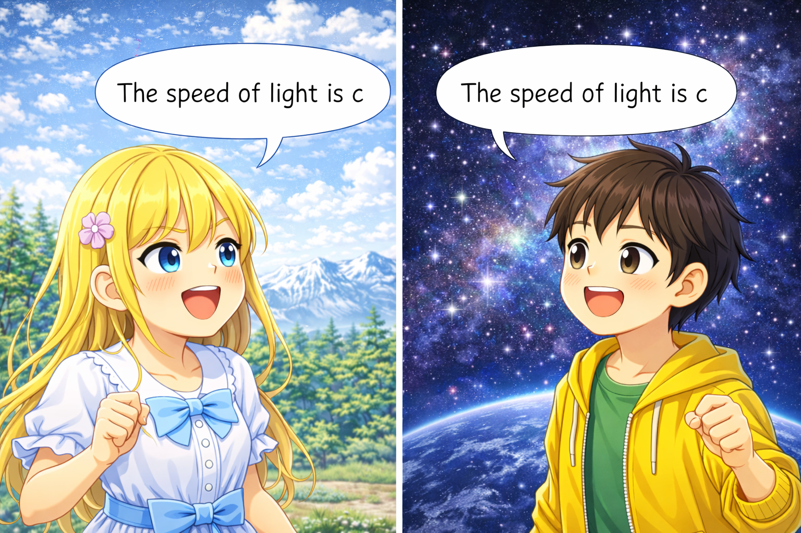

### Coordinate Systems as a Canvas

The coordinate system obtained from the Schwarzschild solution is a canvas coordinate system.

Times and lengths actually experienced or measured are proper time and proper length.

Let us think about this more concretely.

Charlie’s experienced world is of course described by Charlie’s proper time and proper length. The Schwarzschild coordinates $w,r$ happened to coincide with those proper quantities only near Charlie.

So $w,r$ looked like Charlie’s own coordinates, but that is only near Charlie.

Now consider a concrete situation: light bends due to the gravity of a massive star and eventually reaches Charlie.

The bending of light is calculated on the $w-r$ coordinate canvas. But there are limits to understanding how light actually bends near the gravitational field using only the $w-r$ coordinates. What seems more important is that such a calculation can be carried out.

If Charlie places a detector near the strong-gravity region to observe the bending there, that detector uses the local observer’s proper clock and proper ruler at that location. So it is not directly reading raw $w,r$ values.

Therefore, rather than staring at the literal curve drawn in $w-r$, it is better to focus on what happens when the light reaches near Charlie.

Near Charlie, observation is performed in Charlie’s proper time/length, and there those coincide with $w,r$. So the trajectory computed on the canvas is observed directly there (near Charlie).

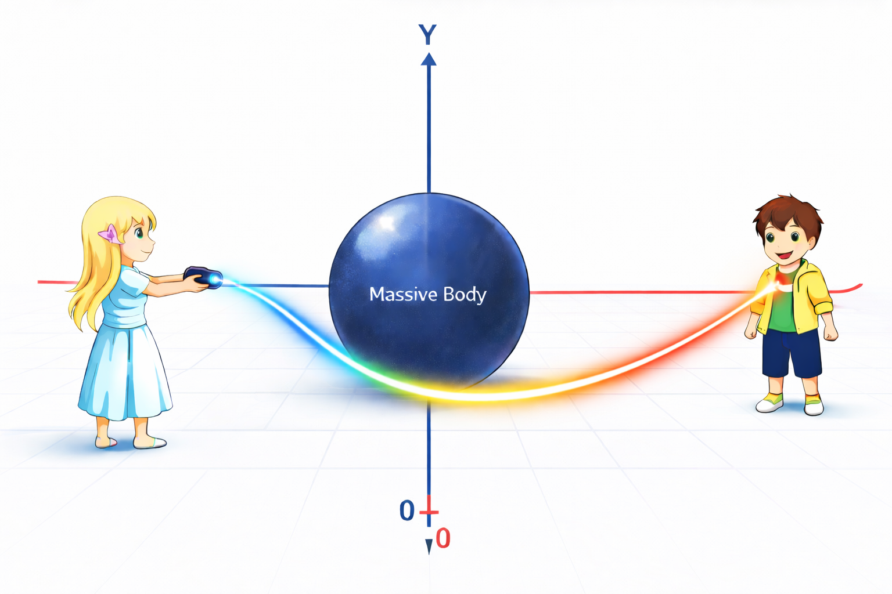

*Figure 2.1: The light trajectory drawn on the coordinate canvas*

In short: near a massive body, what matters is that the trajectory is computable. Even if one places detectors in that region, they do not directly read canvas coordinates themselves. By contrast, when Charlie waits in a far region without felt gravity and observes the arriving light, canvas coordinates and Charlie’s proper units coincide, so he observes the computed canvas trajectory directly there.

### A Freely Falling Observer

Near a single point where Alice measures with the clock and ruler at hand, it seems reasonable to express the metric in the form $\eta_{\mu\nu}$. However, this does not mean that Alice herself, supported by the ground, is in a local inertial frame.

Now let Bob free-fall from Alice’s location. (Bob has a parachute, so no worries.) Since Bob is in free fall, in a very small neighborhood around him he can be treated as if he were at rest in an inertial frame (the metric can be approximated by $\eta_{\mu\nu}$). But strictly, if one extends the region, caution is needed: the local inertial frame must be re-chosen point by point along Bob’s worldline, not one single frame for the entire fall.

Then a natural question appears: if Alice and Bob both locally use $\eta_{\mu\nu}$, are they just in a special-relativistic relative-velocity relation?

From Alice/Charlie, Bob is accelerated, so they are not globally connected by one Lorentz transformation. All three can still use $\eta_{\mu\nu}$ locally around themselves. Where does the difference show up? One place is that accumulated proper times differ.

Let us show the relation.

We already derived Alice–Charlie proper-time relation.

Now examine Bob–Charlie.

Let $w_B-r_B$ denote the coordinates Bob uses in his local inertial frame. The infinitesimal interval $ds^2$ observed by Bob is

$$
ds^{2}=-dw_B^{2}+dr_B^{2}
$$

For the same two spacetime points, Charlie’s coordinates satisfy

$$
ds^{2}=-\left(1-\frac{a}{r_B}\right)dw_C^{2}+\frac{1}{1-a/r_B}dr_C^{2}
$$

Since both describe the same two endpoints and $ds^2$ is a scalar, we can write

$$
ds^{2}=-dw_B^{2}+dr_B^{2}
=-\left(1-\frac{a}{r_B}\right)dw_C^{2}+\frac{1}{1-a/r_B}dr_C^{2}
$$

Now consider Bob’s proper time. Set $dr_B=0$:

$$
-d\tau_B^{2}=-\left(1-\frac{a}{r_B}\right)dw_C^{2}+\frac{1}{1-a/r_B}dr_C^{2},
$$

thus

$$
d\tau_B^{2}
=\left(1-\frac{a}{r_B}\right)dw_C^{2}
-\frac{1}{1-a/r_B}dr_C^{2}
< dw_C^{2}
$$

So at least $d\tau_B<dw_C$ holds.

Now make comparison conditions explicit. If Alice and Bob are at nearly the same radius ($r_A\sim r_B$), gravitational slowing is nearly the same for both. But Bob is moving relative to Alice, so by the special-relativistic motion effect Bob’s clock is further slowed from Alice’s perspective. Therefore

$$
d\tau_B<d\tau_A
$$

Combine with the already shown gravitational relation

$$
d\tau_A<d\tau_C
$$

to get

$$
d\tau_B<d\tau_A<d\tau_C
$$

This conclusion is under the condition that Alice and Bob are compared at nearly the same $r$.

---

Alice: “You’re a boy, so jump!”

Bob: “Give me a break...”

Alice: “Go!”

Bob: “Waaah...!”

---

### Light Signals from Falling Bob

Consider Bob free-falling while emitting blinking light toward Charlie (at infinity). Bob emits once every 1 second on his own proper clock.

For Bob, nothing unusual happens: ordinary time passes, and he emits every second.

But for Charlie, things look different. At first flashes arrive every second, then intervals become longer: every 2 seconds, 5 seconds, 10 seconds, and so on. As Bob approaches Schwarzschild radius $a$, arrival intervals keep stretching.

Quantitatively: at Bob position $r_B$, the relation between Bob proper time $d\tau_B$ and Charlie coordinate time $dw_C$ includes both gravitational and motion effects. Here, to capture the trend, use the static relation as an approximate guide:

$$
d\tau_B = dw_C\sqrt{1-\frac{a}{r_B}}
$$

From this, as $r_B\to a$, a fixed $d\tau_B$ corresponds to very large $dw_C$. So flashes Bob emits every second are received by Charlie with very long spacing. Since Charlie is at infinity, $d\tau_C=dw_C$ holds, so he directly reads that spacing on his own clock.

Also, the received light is redshifted and dimmed. Suppose Bob emits $N$ wave cycles during $d\tau_B$. Charlie receives the same $N$ cycles during $dw_C$. Since frequency is the number of oscillations per unit time, let $\nu_B$ be the frequency emitted by Bob and $\nu_C$ the frequency observed by Charlie:

$$
\nu_B=\frac{N}{d\tau_B},\quad \nu_C=\frac{N}{dw_C},
$$

Therefore, the frequency ratio is

$$
\frac{\nu_C}{\nu_B}=\frac{d\tau_B}{dw_C}
$$

Using the same approximation as above (static relation as guide), substitute $d\tau_B = dw_C\sqrt{1-\frac{a}{r_B}}$:

$$
\frac{\nu_C}{\nu_B}
=\frac{dw_C\sqrt{1-\frac{a}{r_B}}}{dw_C}
=\sqrt{1-\frac{a}{r_B}}
$$

As $r_B\to a$, this ratio approaches zero, so observed frequency becomes arbitrarily small.

When Bob gets arbitrarily close to the horizon ($r=a$), for Charlie the blink interval stretches without bound and almost no light arrives. Bob appears to freeze on the horizon.

However, as Bob approaches the horizon, his falling speed also increases, and the Doppler effect caused by his motion can no longer be ignored. Therefore, the approximation above does not accurately describe the frequency near the horizon. An exact calculation must include both gravitational redshift and the Doppler effect. Nevertheless, the conclusion does not change: the intervals between the flashes reaching Charlie grow longer, and the light becomes redder and dimmer.

This is an extreme manifestation of coordinate-time vs proper-time difference. Bob crosses the horizon in finite Bob proper time, but in Charlie coordinate time Bob reaches the horizon only at “infinite future.” This is the appearance in Schwarzschild coordinates (the $w-r$ canvas). The coordinate light speed

$$
\left|\frac{dr}{dw}\right|=1-\frac{a}{r}
$$

correspondingly approaches zero as $r\to a$.

---

Charlie: “Bob’s flashes are getting slower and slower…”

Alice: “I hope Bob is okay…”

Charlie: “Hmm, a lot of time has passed on our clocks, but I’m sure Bob is experiencing time normally. It’s just that we’re gradually losing sight of him.”

Bob: “I fell quite far. Still feels normal. Maybe I should head back.”

---

### Bob and Charlie Meet Again

Let us add one more thought experiment. Suppose Bob falls freely to a sufficiently deep location, then briefly fires a rocket to reverse direction and return to Charlie at infinity.

Bob fires the rocket at a point with $r>a$, before reaching the event horizon.

Keep thrust duration short; focus on free-motion segments. On the outbound leg, as we have seen, Bob's clock runs slower than Charlie's from Charlie's viewpoint. What about the return leg? On the return leg, Bob is still moving through the gravitational field while ascending, so his proper time still runs slower than Charlie's.

That is, on both outbound and inbound parts,

$$
d\tau_{B} < dw_{C}(=d\tau_{C})
$$

holds in segments along the way. So over the full trip,

$$
\tau_{B,\mathrm{total}}<\tau_{C,\mathrm{total}}
$$

Therefore, when Bob and Charlie reunite at the same place and compare their clocks, Bob’s clock is behind. In other words, Bob is younger.

In general, we cannot say that the delay is exactly twice as large simply because this is a round trip. The size of the difference depends on where Bob turns around and how his velocity changes throughout the journey. What matters is that Bob’s clock continues to run more slowly even as he reverses direction and returns.

---

Bob: “Ah… my clock is behind.”

Charlie: “It really is!”

Alice: “You kept treating me like a little kid, Bob. Looks like the age gap just got a little smaller!”

Bob: “Ugh…” (It’s only a few seconds…)

---

### Metric and Coordinate Transformations

Earlier we wrote expressions such as

$$
ds^{2}=\eta_{\mu\nu}dX^{\mu}dX^{\nu}
$$

$$
=g_{\lambda\sigma}dx^{\lambda}dx^{\sigma},
$$

and explained that a person in a gravitational field, using their own coordinates $x^\lambda$, could calculate the $ds^2$ seen by a person in an inertial frame by multiplying by $g_{\lambda\sigma}$. Let us reconsider this.

The transformation from coordinates $x^\mu$ with metric $g_{\mu\nu}$ to another coordinate system $x'^\lambda$ can be written as

$$
ds^{2}=g_{\mu\nu}dx^{\mu}dx^{\nu}
$$

$$
=g_{\mu\nu}\frac{\partial x^{\mu}}{\partial x'^{\lambda}}dx'^{\lambda}
\frac{\partial x^{\nu}}{\partial x'^{\sigma}}dx'^{\sigma}
$$

$$
=g_{\mu\nu}\frac{\partial x^{\mu}}{\partial x'^{\lambda}}
\frac{\partial x^{\nu}}{\partial x'^{\sigma}}dx'^{\lambda}dx'^{\sigma}
$$

$$
=g'_{\lambda\sigma}dx'^{\lambda}dx'^{\sigma}
$$

So the form is preserved, and the scalar value $ds^2$ is preserved.

Pushing this further: in a local neighborhood around a point, one can transform to coordinates with metric $\eta_{\mu\nu}$. If that coordinate is $X^\mu$, then

$$
ds^{2}=g_{\mu\nu}dx^{\mu}dx^{\nu}
$$

$$
=\eta_{\mu\nu}dX^{\mu}dX^{\nu}
$$

At this point, it begins to seem that our earlier way of thinking may have been backwards. The metric $g_{\mu\nu}$ appears from the outset as the metric for the coordinate system $x^\mu$ under consideration. (Indeed, when finding the Schwarzschild solution, we obtained the coordinate system and the metric together.) Perhaps the point is that we can then also transform locally to coordinates with metric $\eta_{\mu\nu}$.

If we place an experiment anywhere and observe, instruments always measure values based on local proper time and proper length. So transforming to a local $\eta_{\mu\nu}$ coordinate is exactly the transformation that tells us what a local measurement at that place records.

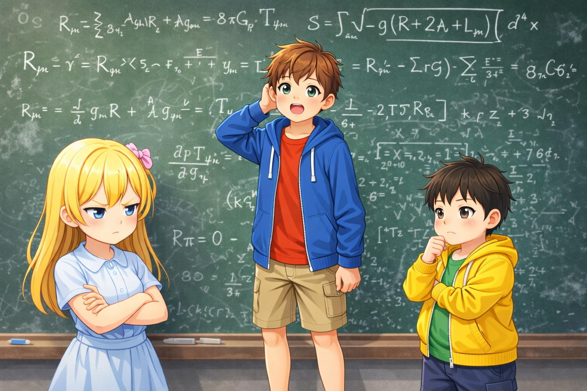

### Interferometer Thought Experiment

In an inertial frame, prepare one light source and place mirrors at distance $L$ on both left and right:

mirror <---------- $L$ ----------> source <---------- $L$ ----------> mirror

Light leaves the source, reflects at both mirrors, returns to the source position, and interferes.

Now move this whole setup into a gravitational field.

Assume the right mirror feels strong gravity while the source and left mirror feel almost none (because $L$ is very large), and assume the apparatus is held static against gravity by some support.

What happens to interference at the source position?

Light making round trips in gravity is affected by spacetime curvature along its path.

As a result, the effective optical path lengths (the round-trip path quantity) for left and right change differently.

So interference fringes shift.

What if the gravitational influence comes not from a celestial body, but from a metric that flies through?

If changes in the metric alter the optical path length, then conversely we can detect such metric changes by observing those shifts.

## Appendix

### Appendix A: Why is $ds^{2}$ Lorentz invariant?

Here, we consider the line element $ds^2$ as a quantity describing the interval between two points in spacetime. In one spatial dimension, using this book’s sign convention, it is defined as

$$
ds^2=-dw^2+dx^2
$$

(Some texts use the opposite sign convention, $ds^2=+dw^2-dx^2$, but the physical content is the same.) Let us verify that this quantity is invariant under Lorentz transformations.

Let the one-dimensional Lorentz transformation be

$$
x_B=\gamma\left(x_A-\frac{V}{c}w_A\right),\quad
w_B=\gamma\left(w_A-\frac{V}{c}x_A\right)
$$

where $w=ct$.

Differentiating gives

$$
dx_B=\gamma\left(dx_A-\frac{V}{c}dw_A\right),\quad
dw_B=\gamma\left(dw_A-\frac{V}{c}dx_A\right)
$$

Setting $\beta=V/c$, we obtain:

$$
\begin{aligned}
-dw_B^2+dx_B^2
&=-\gamma^2(dw_A-\beta dx_A)^2+\gamma^2(dx_A-\beta dw_A)^2\\
&=\gamma^2(1-\beta^2)(-dw_A^2+dx_A^2)\\
&=-dw_A^2+dx_A^2
\end{aligned}
$$

since $\gamma^2(1-\beta^2)=1$.

Hence

$$
ds^2=-dw_A^2+dx_A^2=-dw_B^2+dx_B^2,
$$

so $ds^2$ is invariant.

### Appendix B: Why do SB clocks look desynchronized from SA?

A Minkowski diagram makes this situation easy to understand. When drawn using SA as the reference frame, the SB coordinate axes are oblique. A horizontal line represents “one instant” in SA. Alice sees precisely the world sliced along this horizontal line. Focusing on three SA coordinate clocks as shown in the figure, we can draw three points (events), $e_1,e_2,e_3$, at their respective spatial positions and times.

Looking at it this way, the diagrams we have been drawing of SA and SB overlapping, viewed from SA, were actually diagrams showing the events $e_1,e_2,e_3$ side by side.

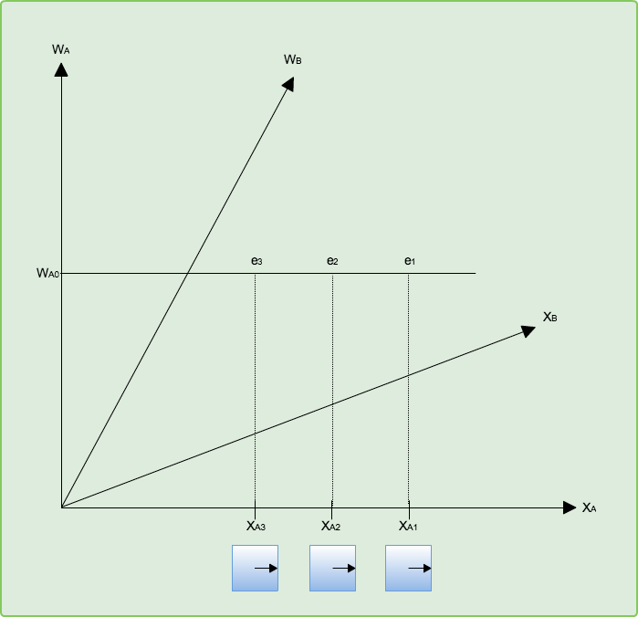

*Figure 3.1: Minkowski diagram, viewed from SA. Consider the three events* $e_1,e_2,e_3$, *which are simultaneous in SA.*

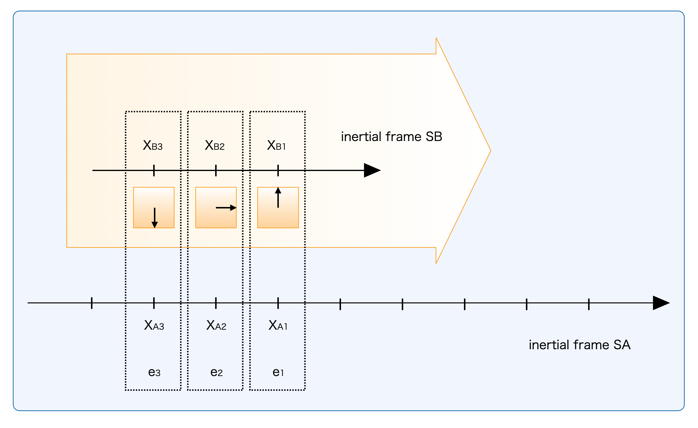

*Figure 3.2 (SA view): Consider three spacetime events,* $e_1,e_2,e_3$. *Event* $e_1$ *is the instant when XB1 and XA1 coincide.*

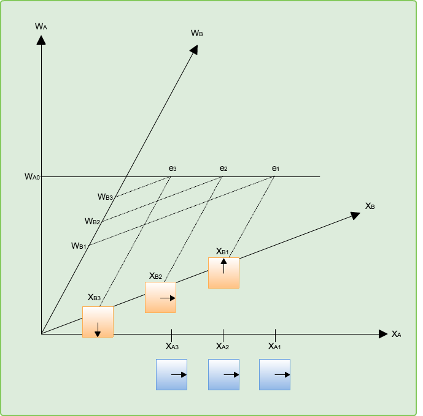

*Figure 3.3 (SA view): Examining the SB times of the three events. The SB time WB3 of event* $e_3$ *is ahead of the SB time WB2 of event* $e_2$.

### Appendix C: Deriving Length Contraction with Lorentz Transformations

Let us compute length contraction of SB as seen from SA using Lorentz transformations.

In SA, at time $t_A=0$, suppose SA marks two simultaneous positions $x_{A0}$ and $x_{A1}$ on the SB side. Compute where those marks lie in SB coordinates:

$$
x_{B0}=\frac{x_{A0}-V\times 0}{\sqrt{1-(V/c)^2}},
$$

$$
x_{B1}=\frac{x_{A1}-V\times 0}{\sqrt{1-(V/c)^2}}
$$

Hence spacing between the two SB marks is

$$
x_{B1}-x_{B0}=\frac{x_{A1}-x_{A0}}{\sqrt{1-(V/c)^2}}
$$

So the spacing is longer than SA spacing, meaning equivalently: if SA measures an SB-rest rod simultaneously in SA, SA gets a shorter length. That already gives the standard result.

But this is not in the same narrative flow as the main text, so below we derive it in the same event-by-event style. If this is enough for you, you can skip the rest.

Rewrite the Lorentz transformation

$$
t_A = \frac{Vx_B/c^2 + t_B}{\sqrt{1-(V/c)^2}}
$$

as

$$
w_A = \frac{Vx_B/c + w_B}{\sqrt{1-(V/c)^2}}
$$

Let the SB-rest rod length be $L_B$, with rear at $x_B=0$ and front at $x_B=L_B$ (SB coordinates). In SB view, at time $w_{B0}$, suppose rod front reaches SA point Q. Compute SA clock reading $w_A(Q)$:

$$
x_B=L_B,
$$

$$
w_B=w_{B0}
$$

So

$$
w_A(Q)=\frac{VL_B/c+w_{B0}}{\sqrt{1-(V/c)^2}}
$$

SA measures rod length at this SA time. Define $w_A(Q)=w_{A0}$ (constant).

Now change viewpoint and work backward from SA’s measurement event. SA measures both endpoints simultaneously at time $w_{A0}$. Seen from SB, front event (Q) and rear event (P) are not simultaneous. Let us compute this simultaneity offset explicitly.

First look at the rear event (P) in SB. The rear endpoint always has

$$
x_B=0
$$

Substitute $w_A=w_{A0}, x_B=0$ into

$$
w_A=\frac{Vx_B/c+w_B}{\sqrt{1-(V/c)^2}}
$$

to get

$$
w_B(P)=w_{A0}\sqrt{1-(V/c)^2}
$$

Next, define X as the rear-endpoint event at the same SB time $w_{B0}$ as front event Q. Then X has $x_B=0,\ w_B=w_{B0}$, so

$$
w_A(X)=\frac{w_{B0}}{\sqrt{1-(V/c)^2}}
$$

From earlier,

$$
w_{A0}=w_A(Q)=\frac{VL_B/c+w_{B0}}{\sqrt{1-(V/c)^2}}
$$

Subtract:

$$
\Delta w_A=w_{A0}-w_A(X)=\frac{VL_B/c}{\sqrt{1-(V/c)^2}}
$$

This is the SA time difference during which the rear endpoint moves from X to P. Therefore

$$
\overline{XP}=V\frac{\Delta w_A}{c}=\frac{V^2L_B/c^2}{\sqrt{1-(V/c)^2}}
$$

Now, from SB viewpoint, SA effectively measures the rod while omitting this X-to-P segment. If SA-measured length $\overline{PQ}$ is $L_A$, then adding $\overline{XP}$ gives $\overline{QX}$.

If SB simultaneously records both rod endpoints as Q and X into SA, then SA length $\overline{QX}$ is

$$
\overline{QX}=\frac{L_B}{\sqrt{1-(V/c)^2}}
$$

(This is what we found at the beginning of Appendix C.)

Therefore

$$
L_A+\frac{V^2L_B/c^2}{\sqrt{1-(V/c)^2}}=\frac{L_B}{\sqrt{1-(V/c)^2}},
$$

and rearranging:

$$
L_A=L_B\sqrt{1-(V/c)^2}
$$

So SA sees the rod contracted by this factor.

*Figure 3.4 (SB view): When the front of the rod reaches point Q in SA, SA records Q as the position of the rod’s front end.*

*Figure 3.5 (SB view): Rod rear moves from SA point X to P*

### Appendix D: Four-Momentum and $E = mc^{2}$

Since this is a relativity book, let us derive $E=mc^2$.

To describe moving objects, define four-velocity:

$$
\mathbf{u}=(u^0,u^1,u^2,u^3)=\left(\frac{dw}{d\tau},\frac{dx}{d\tau},\frac{dy}{d\tau},\frac{dz}{d\tau}\right),
$$

$d\tau$ is proper time of the moving object, and $dw,dx,dy,dz$ are coordinate time/space in the observer coordinates (strictly, with our convention they have length units because of factors of $c$). This is a definition.

Multiply by $mc$ to define four-momentum:

$$
\mathbf{p}=(p^0,p^1,p^2,p^3)=mc\mathbf{u}
=\left(mc\frac{dw}{d\tau},mc\frac{dx}{d\tau},mc\frac{dy}{d\tau},mc\frac{dz}{d\tau}\right)
$$

In one spatial dimension:

$$
\mathbf{p}=(p^0,p^1)=mc\mathbf{u}
=\left(mc\frac{dw}{d\tau},mc\frac{dx}{d\tau}\right)
$$

Up to here, there is no mystery: just definitions.

Now consider the Lorentz-invariant quantity

$$
ds^2=-dw^2+dx^2
$$

Proper time is the time indicated by a clock attached to the object. Looking at the expression above, an object moving by $dx$ during coordinate interval $dw$ carries that attached-clock time as proper time.

For $dx=0$ (object at rest in that coordinate system), coordinate time and proper time coincide:

$$
ds^2=-dw^2+dx^2=-d\tau^2+0^2=-d\tau^2
$$

So $ds^2$ can be written in terms of proper time. In general, relation between attached-clock proper time and observer coordinate variables is

$$
-d\tau^2(=ds^2)=-dw^2+dx^2
$$

Divide by $d\tau^2$:

$$
-1=-\left(\frac{dw}{d\tau}\right)^2+\left(\frac{dx}{d\tau}\right)^2
$$

Multiply by $(mc)^2$:

$$
-(mc)^2=-\left(mc\frac{dw}{d\tau}\right)^2+\left(mc\frac{dx}{d\tau}\right)^2,
$$

rearrange:

$$
\left(mc\frac{dw}{d\tau}\right)^2=(mc)^2+\left(mc\frac{dx}{d\tau}\right)^2
$$

Rewrite using four-momentum symbols:

$$
(p^0)^2=(mc)^2+(p^1)^2
$$

Now take the low-speed limit (speed much smaller than light speed), so $p^1$ is small, and calculate $p^0c$:

$$
p^0c=c\sqrt{(mc)^2+(p^1)^2}
$$

$$
=cmc\sqrt{1+\left(\frac{p^1}{mc}\right)^2}
$$

$$
\simeq mc^2\left(1+\frac{1}{2}\left(\frac{p^1}{mc}\right)^2\right)
$$

Let $t$ denote ordinary time in seconds. Since $d\tau\simeq cdt$,

$$
p^1=mc\frac{dx}{d\tau}\simeq mc\frac{dx}{cdt}=mv_x
$$

Therefore

$$
p^0c\simeq mc^2+\frac{(p^1)^2}{2m}\simeq mc^2+\frac{1}{2}mv_x^2
$$

The kinetic-energy term appears. So the first term $mc^2$ is an energy term existing in addition to kinetic energy. In this way, $p^0c$ is identified as total energy.

## References

- Introductory Physics Course 9: Relativity — Tadao Nakano, Iwanami Shoten
- Spacetime and Gravity — Yasunori Fujii, Sangyo Tosho
- General Relativity — P. A. M. Dirac, Chikuma Gakugei Bunko
- EMAN Physics: <https://eman-physics.net/relativity/contents.html>

## Credits

- Book title: Making Sense of Relativity
- Version: 1.2
- Release date: 2026/10/28
- Author: t-ishii66 / Studied physics at university. Systems engineer. Working hard on spoken English.
- Review: Codex GPT 5.6, Claude Opus 4.5
- Illustrations: Codex GPT 5.6
- Comics: ChatGPT 5.3
- English translation: Codex GPT 6.1 Sol, Claude Opus 4.5, t-ishii66

## Closing

Thank you for reading to the end. This manuscript has been carefully discussed, but if you find any mistakes, please contact us.

Contact form:
https://forms.gle/d5QrngqCdRKYXhzs8

This work is protected by copyright. Partial or full reproduction is prohibited.

Copyright(C) 2026 t-ishii66. All rights reserved.

---

## END
